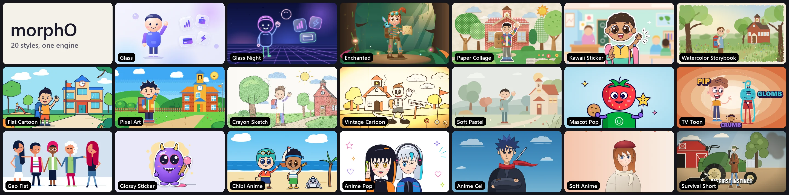
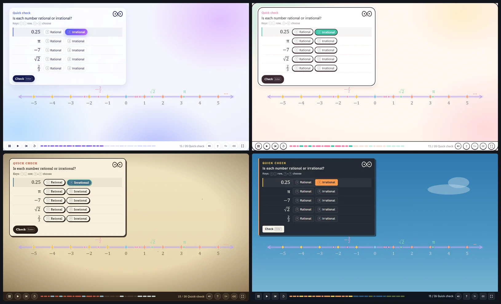

<h1 align="center">morphO</h1>

<p align="center">
  <strong>An agent skill that turns a textbook, a story or an idea into a narrated, animated web book,<br>in one of 20 ready-made styles, from frosted glass to pixel art, crayon and anime.</strong>
</p>

<p align="center">
  
</p>

<p align="center">
  <a href=".claude/skills/morpho/SKILL.md">Read the Skill</a>
  ·
  <a href=".claude/skills/morpho/assets/styles/samples/">Browse the style samples</a>
  ·
  <a href="#get-started">Get started</a>
</p>

You talk to your coding agent; morphO does the rest. It plans the book with you, writes and voices the narration, animates every moment to the spoken words, checks its own frames, and hands you a folder of static web pages: no server, no database, no account. Host it anywhere, or export a chapter as an MP4.

## What it makes

| From | You get |
|---|---|
| A textbook PDF | **Lessons**: formulas, diagrams and scenes that change step by step as the voice explains, with quick checks and practice that are graded |
| A story, a joke or a fairy tale | **Picture books**: animated characters in front of drawn or painted sets, with voices, subtitles, sound and music; for young children, a listen-and-find game |
| A book or an argument | **Documentaries** built from public-domain pictures, and **upright shorts** for a phone feed |
| Maps and numbers | **Scroll stories** whose picture changes as you read, and **maps you explore** year by year |

## Pick a look

Every book starts with a short conversation, and one of its first questions is the look. morphO offers two or three styles that fit your readers and your subject (a toddler's picture book and a history course for teenagers get different suggestions), shows you the samples, and applies the one you pick. A style is two things that belong together:

- **the player's look**: colours, cards, buttons, the progress bar and captions;
- **a character style** the cast is drawn in: soft gloss, neon line, paper cut-out, watercolour wash, crayon, pixel art, rubber hose, chibi, cel-shaded anime, survival-short stick figures and more.

The same lesson in four styles:

<p align="center">
  
</p>

| Style | Mood | Good for |
|---|---|---|
| Glass · Glass Night | frosted cards in lavender light, or deep indigo with neon | maths, science, tech |
| Enchanted | a forest at golden hour, fireflies, gold | fairy tales, adventure, nature |
| Paper Collage | scrapbook paper, gingham, polka dots | young children, crafts |
| Kawaii Sticker | pastel, chibi, thick outlines | young readers, early maths |
| Watercolor Storybook | soft washes on cream paper | picture books, history as a story |
| Flat Cartoon | bright flat colour, navy outlines | school-age explainers |
| Pixel Art | a sunny retro game | coding, games, puzzles |
| Crayon Sketch | a child's drawing on white paper | young children, art |
| Vintage Cartoon | a sepia rubber-hose reel | history, fables, jokes |
| Soft Pastel | muted sage and terracotta | early years, wellbeing |
| Mascot Pop | thick-ink mascots, flat colour | food, kids' science, brands |
| TV Toon | a wonky modern TV cartoon | comedy, character stories |
| Geo Flat | geometric flat people | social studies, training |
| Glossy Sticker | shiny die-cut stickers | space, food, shorts |
| Chibi Anime | big heads on a sunny beach | adventure, travel |
| Anime Pop | vivid hair, glossy eyes, doodles | teen readers, languages |
| Anime Cel | TV-anime cel shading | history, biography, drama |
| Soft Anime | fine line, soft shading | literature, slice of life |
| Survival Short | an upright survival story: stick figures, an overcast farm, big outlined captions | survival stories, safety, shorts |

Prefer something else? The last option is always a palette made from your own book, and a new style is one CSS file, a catalogue entry and a sample scene ([how](.claude/skills/morpho/references/core/style.md#style-presets)).

## Get started

Install the Skill in your project, for Claude Code or OpenCode:

```bash
npx skills add shivox-rgb/morphO --skill morpho --agent claude-code   # or --agent opencode
```

Then type `/morpho`. It finds the PDF in your project (or asks for your story), tells you what kind of book it is, suggests a chapter to try first, and offers a recommended option at every step, so you can click through without typing. Your choices are saved in `style.json`, and every later chapter is made to match.

You need [uv](https://docs.astral.sh/uv/), ffmpeg and Playwright's browsers (`uv run --with playwright playwright install chromium firefox`). Narration is free (Edge TTS online, or Kokoro on your own machine). A few extras are optional and paid, each with its own API key: acted voices from ElevenLabs, and pictures painted by an image model through OpenRouter or OpenAI.

To use the player engine from this repository rather than the default release: `python3 .claude/skills/morpho/scripts/engine.py site --from shivox-rgb/morphO@main`.

## Styles from the command line

```bash
python3 .claude/skills/morpho/scripts/style.py list --tier picture          # styles that suit a picture book
python3 .claude/skills/morpho/scripts/style.py show glass-night             # mood, character look, sample
python3 .claude/skills/morpho/scripts/style.py apply site/my-book kawaii    # restyle a book; run again to switch
python3 .claude/skills/morpho/scripts/style.py remove site/my-book          # back to the book's own look
```

## How it works

A book is planned before it is drawn: chapters or scenes, then a script, then a storyboard. The narration is voiced and every word gets a time, so the picture moves exactly when the words are said. The agent then watches its own output (contact sheets, overlap and blank-frame checks, end-to-end tests, a director's review) and fixes what it sees. Large chapters are made by a team of subagents, each step on the model you choose.

Every book plays in the same player: pause anywhere, step back and forth, change speed, turn on captions, use keyboard shortcuts, and pick up where you left off, with the interface in English, Russian, Chinese, Japanese or Arabic. Each book keeps its own copy of the player, so a book never breaks when the player changes. Any chapter renders to a 1080p MP4 with subtitles, and a course can be packaged for an LMS as SCORM.

## Try it locally

```bash
git clone --depth 1 https://github.com/shivox-rgb/morphO.git
cd morphO
python3 .claude/skills/morpho/scripts/serve.py 8765 site   # example books, at http://localhost:8765/
```

Open `.claude/skills/morpho/assets/styles/samples/index.html` in a browser to see every style with its sample scene.

## Contributing

Fixes and new styles are welcome. Please don't add a copyrighted book, its PDF, or lessons made from one. Agents and people changing the repository: start with [AGENTS.md](AGENTS.md), and run its checks before you push.

## License

[MIT](LICENSE). morphO began as a fork of an MIT-licensed project whose authors' copyright notice is kept in [LICENSE](LICENSE); the example books under `site/` and the player engine come from that original work. The bundled MathJax (`engine/vendor/mathjax`) is under the Apache License 2.0. Pictures, recordings and data under `site/` keep their own licences, listed beside them; a few are non-commercial (CC BY-NC-SA), so they can be shared but not sold.
